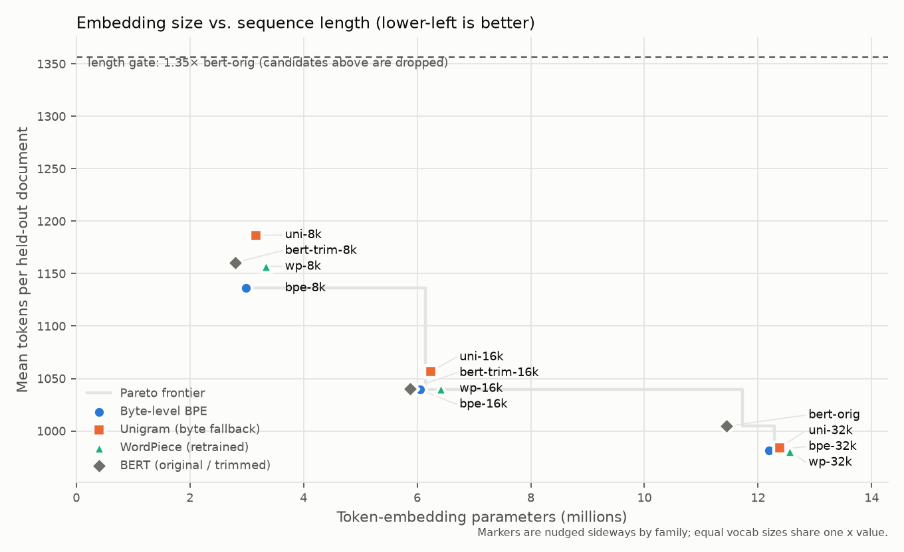

# Phase 3: intrinsic tokenizer evaluation

Run `20260916T181733Z-e77c7ae9`, generated 2026-09-16 18:22 UTC by `leanvocab.intrinsic.run_intrinsic`. All numbers are on the frozen held-out split (10,530 docs, 50.0 MB, 8,082,824 whitespace words, 213,438 paragraphs >= 20 chars; sha256 `917a57c8cad2`).

## Size, compression and vocabulary use

| Tokenizer | Vocab | Total params | Bytes/token | Fertility | Words in >=3 pieces | Rényi eff. (α=2.5) | Vocab used | [UNK] tokens | Docs with [UNK] |
|---|---:|---:|---:|---:|---:|---:|---:|---:|---:|
| bert-orig | 30,522 | 22.47M (1.00×) | 4.726 | 1.309 | 6.7% | 0.4158 | 92.2% | 2.49e-04 | 1.9% |
| bert-trim-8k | 8,000 | 13.82M (0.62×) | 4.091 | 1.512 | 13.5% | 0.5026 | 87.6% | 2.15e-04 | 1.9% |
| bert-trim-16k | 16,000 | 16.89M (0.75×) | 4.563 | 1.355 | 8.3% | 0.4493 | 93.8% | 2.40e-04 | 1.9% |
| bpe-8k | 8,000 | 13.82M (0.62×) | 4.177 | 1.481 | 11.4% | 0.5084 | 98.6% | 0.00e+00 | 0.0% |
| bpe-16k | 16,000 | 16.89M (0.75×) | 4.568 | 1.354 | 7.5% | 0.4575 | 99.0% | 0.00e+00 | 0.0% |
| bpe-32k | 32,000 | 23.03M (1.03×) | 4.838 | 1.278 | 5.2% | 0.4180 | 98.7% | 0.00e+00 | 0.0% |
| uni-8k | 8,000 | 13.82M (0.62×) | 4.002 | 1.546 | 10.9% | 0.4830 | 95.4% | 0.00e+00 | 0.0% |
| uni-16k | 16,000 | 16.89M (0.75×) | 4.494 | 1.376 | 6.5% | 0.4490 | 97.7% | 0.00e+00 | 0.0% |
| uni-32k | 32,000 | 23.03M (1.03×) | 4.824 | 1.282 | 4.1% | 0.4148 | 98.5% | 0.00e+00 | 0.0% |
| wp-8k | 8,000 | 13.82M (0.62×) | 4.103 | 1.508 | 12.4% | 0.5018 | 93.0% | 1.43e-04 | 1.1% |
| wp-16k | 16,000 | 16.89M (0.75×) | 4.564 | 1.355 | 7.9% | 0.4494 | 95.4% | 1.59e-04 | 1.1% |
| wp-32k | 32,000 | 23.03M (1.03×) | 4.841 | 1.278 | 5.6% | 0.4103 | 95.9% | 1.69e-04 | 1.1% |

Total params are for the Phase 4 encoder (6 layers, d=384, FFN 1536, 256 positions, tied embeddings, no MLM head); the ratio is against bert-orig. Rényi efficiency divides by log2 of the full vocab size (Zouhar et al., 2023); `metrics.json` also has the observed-types variant, and both match `tokenization-scorer` in the unit tests.

## Sequence length, truncation and compute

| Tokenizer | Mean doc len | vs ref | p95 doc len | Docs cut @128 | Docs cut @256 | Docs cut @512 | Mean para len | Paras cut @128 | Paras cut @256 | Paras cut @512 | FLOPs/doc @256 | FLOPs/para | Length gate |
|---|---:|---:|---:|---:|---:|---:|---:|---:|---:|---:|---:|---:|:---:|
| bert-orig | 1005 | 1.000× | 2852 | 97.4% | 84.5% | 59.5% | 49.4 | 7.17% | 0.97% | 0.10% | 1.000× | 1.000× | pass |
| bert-trim-8k | 1161 | 1.155× | 3299 | 98.6% | 88.1% | 65.1% | 57.0 | 10.13% | 1.63% | 0.15% | 1.015× | 1.141× | pass |
| bert-trim-16k | 1040 | 1.036× | 2949 | 97.7% | 85.6% | 60.8% | 51.1 | 7.84% | 1.13% | 0.11% | 1.004× | 1.032× | pass |
| bpe-8k | 1137 | 1.131× | 3214 | 98.5% | 87.7% | 64.4% | 56.2 | 9.69% | 1.51% | 0.14% | 1.013× | 1.126× | pass |
| bpe-16k | 1039 | 1.035× | 2955 | 97.7% | 85.6% | 60.7% | 51.3 | 7.86% | 1.12% | 0.11% | 1.004× | 1.036× | pass |
| bpe-32k | 981 | 0.977× | 2785 | 97.1% | 84.1% | 58.5% | 48.4 | 6.83% | 0.92% | 0.10% | 0.998× | 0.982× | pass |
| uni-8k | 1186 | 1.181× | 3347 | 98.7% | 88.7% | 66.0% | 58.6 | 10.61% | 1.74% | 0.17% | 1.017× | 1.169× | pass |
| uni-16k | 1056 | 1.052× | 2983 | 97.9% | 85.9% | 61.3% | 52.1 | 8.16% | 1.20% | 0.12% | 1.006× | 1.050× | pass |
| uni-32k | 984 | 0.980× | 2800 | 97.3% | 84.2% | 58.6% | 48.4 | 6.88% | 0.94% | 0.10% | 0.998× | 0.981× | pass |
| wp-8k | 1157 | 1.152× | 3272 | 98.6% | 88.1% | 65.1% | 56.9 | 10.04% | 1.58% | 0.15% | 1.015× | 1.138× | pass |
| wp-16k | 1040 | 1.036× | 2933 | 97.7% | 85.6% | 60.7% | 51.1 | 7.83% | 1.12% | 0.11% | 1.004× | 1.032× | pass |
| wp-32k | 981 | 0.976× | 2778 | 97.1% | 84.0% | 58.5% | 48.2 | 6.80% | 0.90% | 0.09% | 0.997× | 0.978× | pass |

Lengths exclude `[CLS]`/`[SEP]`; truncation counts a sequence as cut when its tokens plus 2 specials exceed the limit. FLOPs are forward-pass estimates (2·N_layers·L + 2·n_layers·L²·d) with L capped at 256, relative to bert-orig. Most held-out documents are longer than any limit, so paragraph-level numbers are the closer proxy for sentence-embedding inputs.

## Tokenization throughput (M5 Pro)

| Tokenizer | Single thread (docs/s) | Single thread (MB/s) | Batched, all cores (docs/s) | Batched (MB/s) |
|---|---:|---:|---:|---:|
| bert-orig | 932 | 4.26 | 5162 | 24.5 |
| bert-trim-8k | 923 | 4.22 | 5285 | 25.1 |
| bert-trim-16k | 940 | 4.30 | 5392 | 25.6 |
| bpe-8k | 732 | 3.35 | 4226 | 20.1 |
| bpe-16k | 726 | 3.32 | 4254 | 20.2 |
| bpe-32k | 722 | 3.30 | 4228 | 20.1 |
| uni-8k | 780 | 3.57 | 3584 | 17.0 |
| uni-16k | 772 | 3.53 | 3530 | 16.8 |
| uni-32k | 746 | 3.41 | 3519 | 16.7 |
| wp-8k | 922 | 4.21 | 5181 | 24.6 |
| wp-16k | 940 | 4.30 | 5451 | 25.9 |
| wp-32k | 946 | 4.33 | 5542 | 26.3 |

Single thread: `encode()` over the first 2,000 docs; batched: `encode_batch()` in chunks of 512; median of 3 runs after a warm-up. Includes offset computation.

## Pareto view

## Go/no-go #1: proposed finalists

Rule applied: drop any candidate whose mean document length exceeds 1.35× bert-orig; among the rest, rank each claim vocab size by bytes/token (inference cost), ties by Rényi efficiency. **This is a proposal for review, not a decision.**

- **8k:** ranked bpe-8k, wp-8k, uni-8k; dropped by gate: none.
- **16k:** ranked bpe-16k, wp-16k, uni-16k; dropped by gate: none.

Always in Phase 4 regardless: the control `bert-orig`, Baseline A (factorized 30,522×128 embeddings) and Baseline B (`bert-trim-*` at the finalist sizes). 32k tokenizers have more parameters than the control and are reference points only.
